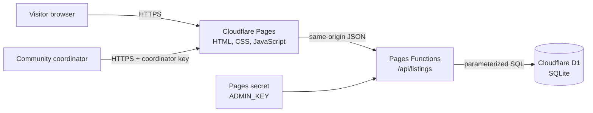

# SharePlate: A Cloud-Based Neighborhood Food-Sharing System

**Project report**

## Executive summary

SharePlate is a proposed cloud-hosted web service for coordinating the short-lived surplus food that arises at neighborhood markets, bakeries, community kitchens and similar providers. It gives a local provider a way to publish an offer, and lets a visitor discover it, reserve a number of portions and see the remaining quantity update. The aim is deliberately practical: make food intended for people easier to redirect locally, rather than treating disposal as the default. The project is implemented as a working pilot with a responsive browser interface, server-side API endpoints, relational persistence and an explicit free-tier deployment path.

The application separates static assets from request handling. Cloudflare Pages serves the HTML, CSS and JavaScript; Pages Functions implement the API at the edge; and a Cloudflare D1 SQLite database stores offers and claim counts. The user interface uses browser-native technologies rather than a framework, keeping the bundle small and the deployment build simple. A coordinator secret guards listing creation, while a conditional database update prevents a claim from taking more portions than remain. Fictional seed records make the project demonstrable without representing real organizations or availability.

SharePlate is a pilot, not a fully governed food-distribution marketplace. A shared coordinator key is not a substitute for identity and access management, and anonymous claims are only reservation counters. The report therefore describes both the implemented capability and what must be added before real public operations: verified provider accounts, safety and legal review, abuse controls, operational procedures and a confirmed handoff process.

## 1. Problem and research basis

Food waste is an environmental and social problem with a substantial coordination component. Food can remain edible and useful while a shop, kitchen or event has no reliable way to connect its surplus with a community organization or person able to collect it promptly. The barriers are temporal and local: the quantity changes quickly, pickup windows are short, and providers need a low-friction way to communicate what is available and any relevant handling information. A general classified listing or static directory does not model changing portions or reservations.

The United Nations Environment Programme’s *Food Waste Index Report 2024* describes the need to measure food waste across household, food-service and retail settings, improve the quality and comparability of measurement, and turn better data into reduction action. Its central relevance to this project is not that an application alone can solve food waste, but that interventions need a practical operating model and measurable outcomes. SharePlate offers a narrow, observable unit of activity—published offers and portions reserved—which could support a later evaluation. These operational counters are not a validated estimate of food saved: a reservation does not prove a collection, consumption, or avoided disposal. A responsible evaluation would verify handoffs and document a measurement method before publishing impact claims.

The U.S. Environmental Protection Agency’s Wasted Food Scale places prevention, donation and upcycling among the preferred pathways because they keep food serving its intended purpose, while disposal options sit lower on the scale. Although this project is not limited to the United States, the ordering supports the design choice to facilitate donation and redistribution rather than create a food-waste disposal tracker. This is a prioritization principle, not a guarantee that every listed item is suitable to donate or that donation is preferable in every circumstance.

Research and operational guidance also impose a safety constraint: redistribution must not become a reason to offer unsafe, recalled, expired, poorly stored or inaccurately described food. SharePlate communicates pickup and provider notes and prompts the provider to include allergen and storage details. That interface reminder is not food-safety certification. The pilot neither checks temperature history nor verifies labels, licenses, allergens or the identity of a provider. The applicable food-safety and donation rules depend on the jurisdiction and the type of food. A real operator must consult local authorities and qualified food-safety professionals, define acceptance criteria, train providers and establish a procedure for recalling or removing an offer.

The target users are small surplus providers, volunteer coordinators, community fridges and local recipient organizations. The system’s initial scope focuses on a single locality and short-term offers. It does not attempt to provide payments, delivery routing, identity verification, food inspection, recipient eligibility decisions, or a carbon-impact calculator. Excluding these functions reduces unnecessary data collection and helps keep the first implementation understandable.

## 2. Requirements and success criteria

The core functional requirements are: (1) visitors can view current, not-yet-expired offers; (2) visitors can search and filter the displayed offers; (3) a coordinator can publish a bounded offer with a category, quantity, neighborhood, pickup time and optional notes; (4) a visitor can claim a positive whole number of portions, only while the offer has enough portions remaining; and (5) the interface reports server and validation errors rather than silently presenting stale or invented data. The implementation uses a coordinator key supplied as a secret request header for creation. Claims remain anonymous counters.

The quality goals are usability on common mobile and desktop screens, semantic and keyboard-operable controls, minimal third-party data transfer, server-side validation, parameterized database statements, and a small deployment footprint. The interface provides labels, visible focus states, `aria-live` status messages, reduced-motion handling, and responsive layouts. It does not require client-side build tooling or send search queries to an external service. Fonts use local system fallbacks, and no analytics or third-party tracking code is included.

The pilot can be checked against concrete acceptance criteria: the offer feed returns persisted rows; invalid categories and malformed input are rejected; listing creation without a correct coordinator key is rejected; quantities outside configured bounds are rejected; a claim cannot reduce availability below zero; and a failed API request is visibly reported. Focused Node tests cover the endpoint validations and conflict response. These tests do not replace integration tests against Cloudflare’s production runtime or a food-safety evaluation.

## 3. Architecture

The browser and API share an origin, simplifying deployment and avoiding cross-origin configuration. Pages serves static assets from the project directory. Files under `functions/api/` define server-side routes: `GET /api/listings` returns up to 100 future available offers, `POST /api/listings` validates and creates an offer, and `POST /api/listings/:id/claim` atomically reserves portions. The API does not expose database credentials or the coordinator secret to the browser. The coordinator key is supplied as a secret header and is not saved in local storage.

The relational model is intentionally small. A `listings` row stores a generated identifier, title, allowed category, total and remaining portions, neighborhood, pickup time, provider notes, status and creation time. A `claims` row records the quantity and time of a reservation with a foreign key to its listing. Checks constrain categories, lengths and numeric ranges; indexes support the available-status/time and category/status/time access paths. The listing table is the authoritative counter, so the interface can update from one remaining-portion value without recalculating it from all historical claims.

Claiming is a concurrency-sensitive operation. The API submits a D1 batch: first, a single conditional `UPDATE` subtracts the requested quantity only if the listing is still available, the pickup time has not passed and the remaining quantity is sufficient; second, an insert records the claim only when the immediately preceding update changed a row. D1 batches execute transactionally. If the guarded update did not change a row, the function returns HTTP 409 so the visitor can reload. This makes over-claiming harder under simultaneous requests than a read-then-write sequence. The API also validates quantity bounds before reaching the database.

The interface renders database strings as text rather than trusting supplied markup; it bounds user input and uses parameterized SQL statements. Errors are returned as JSON and displayed in the page. Listing creation fails explicitly if the server secret is missing, preventing accidental open submission after misconfiguration. The public listing feed returns fields needed for discovery and omits the claims table.

## 4. Technology choices and trade-offs

**Cloudflare Pages** is selected because it can serve the static frontend and run Pages Functions without a separately managed virtual machine. Its Git-connected deployment model supports repeatable publishing from a repository, HTTPS and a public `pages.dev` address. The provider documents Pages Functions as a way to add server-side application behavior, including form handling, without operating a dedicated server. Cloudflare’s free plan currently includes access to D1, subject to plan terms and quotas; users should check current pricing and limits rather than assume they remain unchanged.

**D1** supplies managed SQLite semantics, keeping this small relational workload serverless and close to its API. Offers and claims have a clear parent-child relationship, constrained values and transactional counter changes, so a relational database is more direct than a document store for this version. SQLite’s familiar schema and local Wrangler workflow make it approachable for an educational project. D1 is not selected because it is universally better than a managed PostgreSQL service: an application needing complex analytics, many concurrent write-heavy tenants, elaborate access policies or portability guarantees should evaluate PostgreSQL and other providers.

**Plain HTML, CSS and JavaScript** avoid a compile pipeline and extra dependencies for a small interaction set. The browser uses Fetch for same-origin JSON requests and the native dialog element for the claim flow. The trade-off is that this project does not gain a component framework’s conventions, automatic type checking, or mature form-state tooling. As the application grows, typed modules and a component framework may become worthwhile, but they would increase setup and output size without solving the current core problem.

**Wrangler** provides the local Pages development server and D1 schema commands, and supports deployment and secret management from the command line. The repository includes a Wrangler configuration and npm scripts so local operation and deployment are discoverable. Cloudflare’s dashboard is also documented as a practical Git-connected deployment route. The project does not rely on a separate API vendor, map provider or authentication service.

## 5. Data, privacy and security

The pilot follows data minimization: it stores offer details and anonymous claim quantities, not names, email addresses, phone numbers, exact recipient locations, payment details or user profiles. The neighborhood is free text and should be no more precise than needed for a pickup. The application does not currently define an automatic deletion schedule, and time-expired rows remain in the database even though they are excluded from the public feed. Before production, operators should decide how long completed and expired records are retained, who can access them, and how deletion and backups are handled.

The `ADMIN_KEY` design offers a narrow barrier against casual public listing submissions. The secret belongs in Cloudflare’s secret store or Wrangler’s ignored local `.dev.vars`; it must never be committed to source control or embedded in client JavaScript. A shared key is nevertheless weak identity management: it is hard to revoke for one person, cannot attribute a listing to an organization, and offers no user-level audit trail. The production version should use authenticated organization accounts with role-based authorization, credential rotation and a documented recovery process. The key must be transported only over HTTPS, and secrets must not be written to logs.

Claims are currently open to anyone who can reach the public endpoint. A caller could reserve portions without collecting them or automate requests. Conditional updates protect inventory integrity, but they do not prove good intent, limit a user’s total reservations, or deter denial of service. Production operations need abuse monitoring, request throttling, verification and likely an explicit claim confirmation or cancellation process. Cloud provider defaults are not a substitute for application-level controls.

The API uses SQL bindings, server-side validation, fixed table and column references, response content types, and no permissive cross-origin headers. The browser inserts user-provided strings as text. Deployment should still use platform-managed HTTPS, carefully scoped dashboard access, secret rotation, dependency updates and review of security advisories. A formal threat model and privacy impact assessment should be repeated when authentication, contact data or location functionality is introduced.

Food handling is a parallel safety domain rather than a software feature that can be solved by escaping strings or validating schemas. Providers are responsible for accurate content and safe handoff. Before launch, the operating organization must set its own item acceptance rules and escalation contact, confirm which local laws apply, and provide clear procedures for allergen disclosure and removal of unsafe offers. The product should avoid language implying that an offer is inspected or guaranteed.

## 6. Deployment and operations

For local development, install Node.js and the project’s npm development dependency, create a local `.dev.vars` containing `ADMIN_KEY`, initialize the local D1 database with `db/schema.sql`, optionally run `db/seed.sql`, and use `npm run dev`. The sample seed records are fictional. The README contains the exact commands and describes how to avoid exposing the coordinator secret.

For a free public pilot, create a Cloudflare account, create a D1 database, connect the GitHub repository to Pages, use this project directory as the root, and set the output directory to `.` with no build command. Configure a D1 binding named `DB`, add `ADMIN_KEY` as a secret in Pages settings, and run the schema against the remote database using Wrangler. The optional seed script makes the public page visibly populated for a demonstration. After configuration, redeploy and test the public URL, creation authorization, filtering, claims, and function logs. Provider limits, account requirements, terms, and availability may change; verify them at deployment time.

The repository includes focused API tests that run with `npm test`, syntax-check commands and a schema/seed suitable for local D1. A practical release pipeline should add automated tests for UI accessibility, function integration against a local D1 database, dependency scanning, preview deployments and a smoke test after each release. Monitoring should track function failures and database errors while avoiding unnecessary user data in logs. The operating team needs a named contact for incorrect offers, a rollback procedure, and a process to restore data from backups. Free-tier hosting does not itself constitute an availability or recovery guarantee.

## 7. Evaluation, limitations and future development

The first evaluation should take place with a small number of providers and community organizations in one locality. Useful measures include time from publishing to claim, the share of claimed offers actually collected, number of repeat providers, cancellations, uncollected portions and reports of inaccurate or unsafe listings. Interviews should assess whether the workflow fits the provider’s closing routine, whether collection instructions are clear, and whether a shared service is accessible to people with different devices and language needs. These measures should be reported with definitions and limitations; the project must not translate reservation counts directly into kilograms of food or emissions avoided.

The design’s largest current limitation is operational coordination. A claim reduces availability but gives neither party a contact channel or a guaranteed handoff. Anonymous access also means there is no user-level cancellation or trust history. Next, the system could add verified organization accounts and secure messaging or provider contact rules, then a confirmed collection lifecycle with expiration and cancellation. A moderation and reporting flow would allow removal of unsuitable listings. Localization, stronger keyboard and screen-reader testing, and clear language alternatives should be tested with intended users, not assumed from the responsive layout.

As demand grows, future engineering could add role-aware audit records, metrics with privacy safeguards, tested database backups, rate limits, CAPTCHA or proof-of-work alternatives for abuse, and automated cleanup of expired listings. Geographic discovery should be introduced only if it provides value beyond neighborhood text and can be implemented without collecting precise recipient location. A scale-up decision should be based on measured latency, write contention, support workload and data-retention needs, not a speculative need to adopt microservices. Keeping the first service as a small, single-purpose application makes its behavior easier to explain and evaluate.

## Conclusion

SharePlate turns a real coordination gap into a tangible cloud application: current local surplus can be listed, searched and reserved with a server-side inventory guard. Its design places donation-oriented reuse ahead of disposal, keeps the initial data model small, and uses a free-tier serverless architecture that can be deployed from GitHub. Just as importantly, it makes clear where software stops: a listing is not food-safety verification, a reservation is not a collected meal, and a shared secret is not production identity management. A careful, measured pilot—with local food-safety oversight and a verified handoff process—is the appropriate next step.

## References

1. United Nations Environment Programme. (2024). *Food Waste Index Report 2024*. https://wedocs.unep.org/handle/20.500.11822/45230
2. U.S. Environmental Protection Agency. (2024). *Wasted Food Scale*. https://www.epa.gov/sustainable-management-food/wasted-food-scale
3. Cloudflare. *Pages Functions*. https://developers.cloudflare.com/pages/functions/
4. Cloudflare. *Cloudflare D1*. https://developers.cloudflare.com/d1/
5. Cloudflare. *D1 database bindings for Pages Functions*. https://developers.cloudflare.com/pages/functions/bindings/#d1-databases
6. Cloudflare. *Get started with D1*. https://developers.cloudflare.com/d1/get-started/
